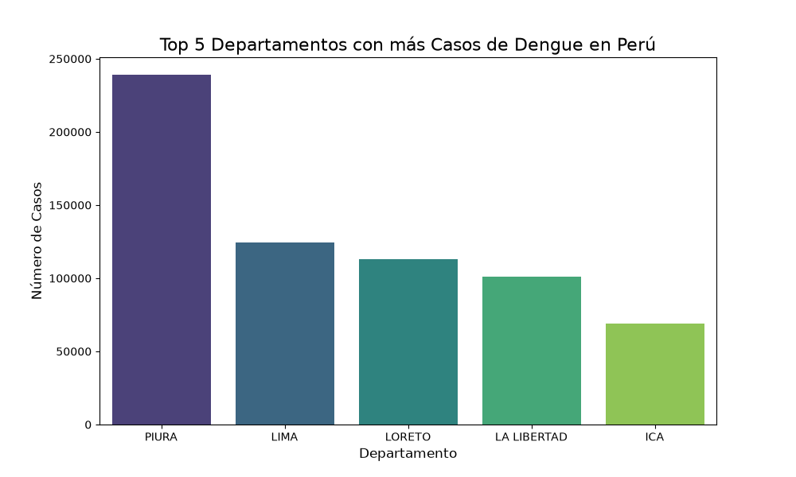
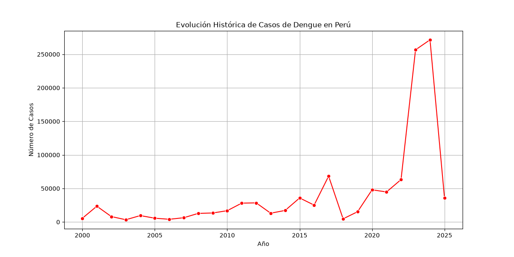

# Análisis de Datos de Dengue en Perú 🦟📊

Este es mi primer proyecto de Ciencia de Datos aplicada a la Salud (Health Data Science). 
El objetivo es explorar los datos abiertos del Ministerio de Salud (MINSA) sobre el Dengue en Perú.

## 🛠️ Herramientas utilizadas
- Python 🐍
- Pandas (Análisis de datos)
- Matplotlib y Seaborn (Visualización)

## 📈 Hallazgos principales
- El departamento con más casos registrados es **Piura** con más de 239,000 casos.
- La mayoría de los casos son de tipo de diagnóstico **Clínico**.
- La columna con más datos faltantes es `localcod` (código de localidad), la cual fue limpiada rellenando los vacíos con "NO REGISTRADO".

## 📷 Visualizaciones

## 🤖 Machine Learning

Como paso final, se prepararon los datos para entrenar modelos que intenten predecir el tipo de diagnóstico (`tipo_dx`) utilizando las variables: edad, sexo y departamento.

Se compararon 3 algoritmos:
  * **Random Forest:** 62.71% de precisión.
  * **Regresión Logística:** 58.07% de precisión.
  * **XGBoost:** 89.70% de precisión (este resultado es engañoso debido al fuerte desbalance de clases: la mayoría de casos son clínicos, por lo que el modelo tiende a predecir siempre esa clase).

**Conclusión del modelo:** El departamento (`depto_num`) es la variable más influyente (92% de importancia). La matriz de confusión demuestra que, aunque el modelo acierta la mayoría de los casos clínicos, todavía tiene dificultades para detectar los casos "Probables" basándose solo en datos demográficos, lo que demuestra que el diagnóstico preciso requiere de pruebas de laboratorio.
## 📊 Origen de los Datos

La base de datos utilizada para este análisis (más de 200,000 registros) no se incluye en este repositorio debido a su gran tamaño. 

Puedes descargar el archivo `.csv` original directamente desde el portal oficial de Datos Abiertos del Estado Peruano:
🔗 [Vigilancia Epidemiológica de Dengue - MINSA](https://www.datosabiertos.gob.pe/dataset/vigilancia-epidemiol%C3%B3gica-de-dengue)
