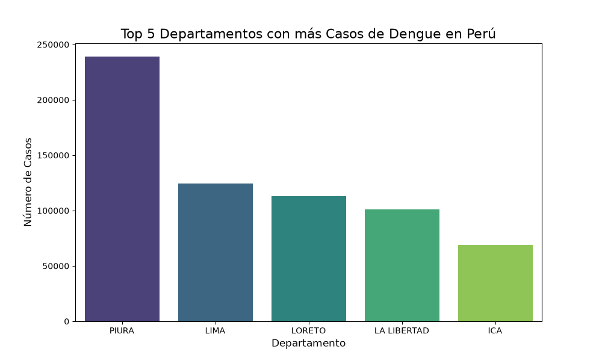
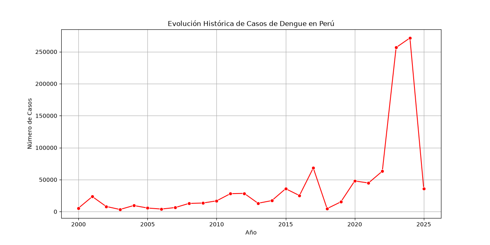

# Análisis de Datos de Dengue en Perú 🦟📊

Este es mi primer proyecto de Ciencia de Datos aplicada a la Salud (Health Data Science). 
El objetivo es explorar los datos abiertos del Ministerio de Salud (MINSA) sobre el Dengue en Perú.

## 🛠️ Herramientas utilizadas
- Python 🐍
- Pandas (Análisis de datos)
- Matplotlib y Seaborn (Visualización)

## 📈 Hallazgos principales
- El departamento con más casos registrados es **Piura** con más de 239,000 casos.
- La mayoría de los casos son de tipo de diagnóstico **Clínico**.
- La columna con más datos faltantes es `localcod` (código de localidad), la cual fue limpiada rellenando los vacíos con "NO REGISTRADO".

## 📷 Visualizaciones

